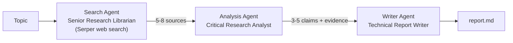
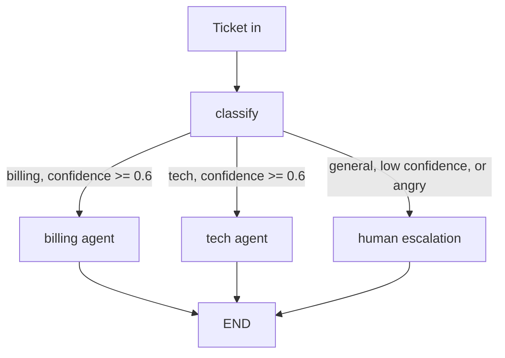
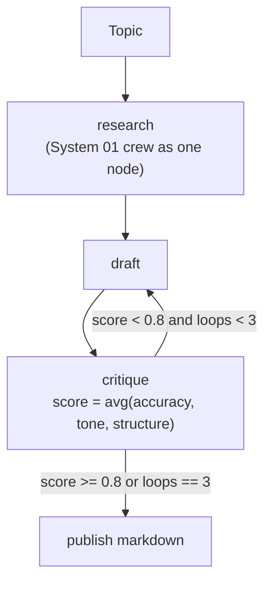

# Multi-Agent Systems Portfolio

Three small multi-agent systems built with **CrewAI** and **LangGraph**, each showing a different orchestration pattern: task delegation, conditional routing with human escalation, and a self-correcting quality loop.

| # | System | Framework | Pattern |
|---|--------|-----------|---------|
| 01 | [Research Assistant Crew](system-01-research-crew) | CrewAI | Sequential hand-off between specialist agents |
| 02 | [Support Triage Graph](system-02-support-triage) | LangGraph | Classify, conditional routing, human escalation |
| 03 | [Autonomous Content Pipeline](system-03-content-pipeline) | LangGraph + CrewAI | Research sub-crew, draft/critique loop with a hard cap |

Everything runs on free-tier LLM APIs (Gemini or Groq) through [LiteLLM](https://github.com/BerriAI/litellm), so no paid key is required.

---

## System 01: Research Assistant Crew

A topic goes in; a structured, sourced report comes out.



- Three agents with distinct roles, goals and backstories, so outputs do not blur into one generic voice.
- The Analyst and Writer have no tools and `allow_delegation=False`; they only reason over what they are handed.

```bash
python system-01-research-crew/main.py
```

## System 02: Customer Support Triage Graph

A ticket is classified, routed to a specialist, or escalated to a human.



- The classifier returns JSON (`category`, `confidence`, `reasoning`). The route is **derived and validated in code**, so a malformed or unexpected reply escalates instead of crashing the graph.
- Angry sentiment (simple keyword check) always escalates.
- Billing and tech agents use mocked tools (`get_order`, `issue_refund`, `search_kb`) that can be swapped for real APIs. The refund amount is computed in code and passed to the model as facts, so the model cannot invent amounts.
- Escalations are written to `escalations.jsonl` as a stand-in for a Slack channel or queue.

```bash
python system-02-support-triage/main.py                    # runs 4 sample tickets
python system-02-support-triage/main.py "My app keeps crashing"
```

## System 03: Autonomous Content Pipeline

A LangGraph loop wraps System 01's crew as a node, drafts a post, critiques it, and revises until a quality gate passes.



- The critique returns three sub-scores plus specific feedback; the score is averaged **in code**, not by the model.
- The loop is capped at 3 passes. If the cap is hit below the threshold, the post is still written but flagged "needs human review".
- The draft node receives the previous draft and the critique feedback on revision passes.

```bash
python system-03-content-pipeline/main.py "Why agentic AI needs typed tool calls"
```

---

## Design Decisions

- **Agents without delegation (Systems 01 and 03).** The Analyst and Writer cannot hand work back to the Searcher, which keeps the pipeline from looping or stalling on ambiguous queries.
- **Sequential crew instead of a manager agent.** The three steps are strictly ordered and each depends on the previous output, so a manager would add LLM calls and failure modes without adding capability.
- **Routing decided in code, not by the model (System 02).** The LLM supplies a category and confidence; plain Python validates them and picks the edge. Free-text classifier output is the most common way a conditional edge breaks.
- **Facts in, prose out.** Anything numeric (refund amounts, scores) is computed in code. Early on, the billing agent told a customer a refund was $58 when the system had refunded $29; computing the amount first and passing it in fixed that.
- **A hard cap on the critique loop.** A quality threshold alone can run forever; pairing it with `loops < 3` bounds both time and API usage.
- **Provider-agnostic LLM layer.** A small shared helper (`llm_utils.py`) adds retry with backoff for 429/503 errors and fails fast on exhausted daily quotas.

## What I Would Add for Production

Left out on purpose to keep the projects focused: authentication and role-based access, audit logging, human approval gates on refunds, a persistent checkpointer (SQLite) so an escalated ticket can resume, evaluation sets for the classifier and critique, and real integrations in place of the mocked tools.

## Known Limitations

- Free-tier rate limits apply. Groq's free tier caps tokens per minute, so prompts and search results are kept small (`n_results=5`, `max_tokens=1500`).
- CrewAI adds a prompt-caching field that Groq rejects; `agents.py` strips it before the request is sent.

## Setup

```bash
python -m venv venv
venv\Scripts\activate           # Windows   (macOS/Linux: source venv/bin/activate)
python -m pip install -r requirements.txt
copy .env.example .env          # then add your own keys
```

`.env` needs one LLM key (Gemini or Groq), the model name, and a Serper key for web search:

```
GROQ_API_KEY=...
LLM_MODEL=groq/openai/gpt-oss-20b
SERPER_API_KEY=...
```

Never commit `.env`; it is listed in `.gitignore`.

## Results

<!-- Replace with numbers you measured yourself from a few runs. -->
- Sample run time per system: _TBD_
- Average critique loops before publish (System 03): _TBD_
- Share of test tickets routed correctly (System 02): _TBD_

<!-- Add a demo GIF or screenshot here:  -->

## Project Layout

```
multi-agent-portfolio/
├── system-01-research-crew/      agents.py, tasks.py, main.py
├── system-02-support-triage/     nodes.py, graph.py, main.py
├── system-03-content-pipeline/   crew_node.py, nodes.py, graph.py, main.py
├── llm_utils.py                  shared LLM helper (retry, JSON parsing)
├── requirements.txt
├── .env.example
└── .gitignore
```

Based on the build guide "3 Multi-Agent Systems" by @dipanshu.decoded, adapted to run on free-tier providers with additional validation and guardrails.